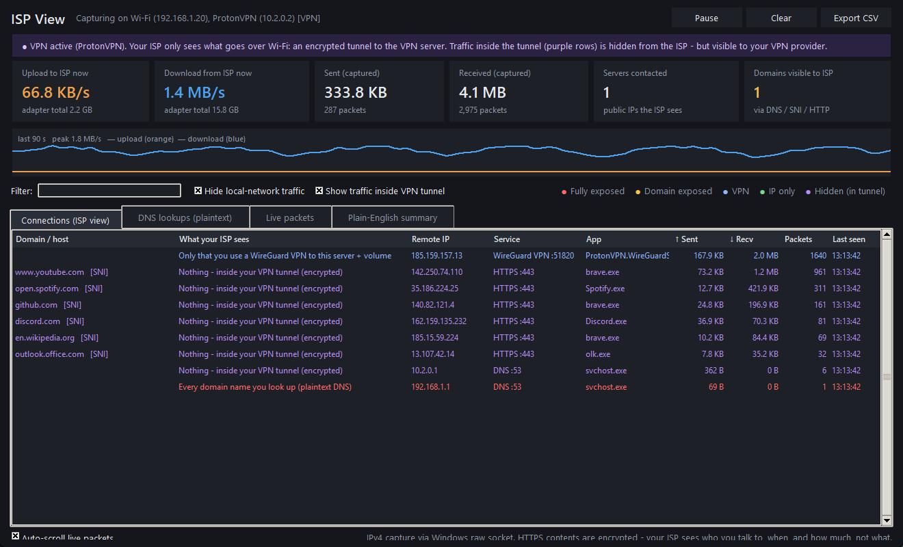
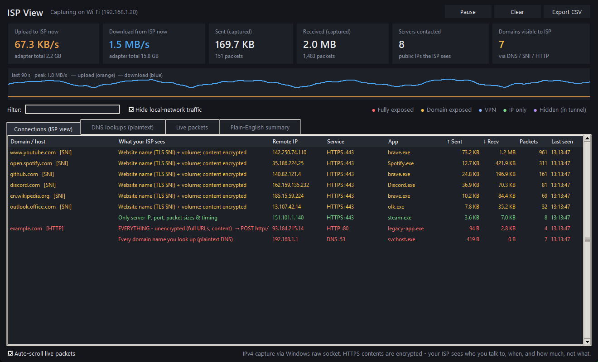
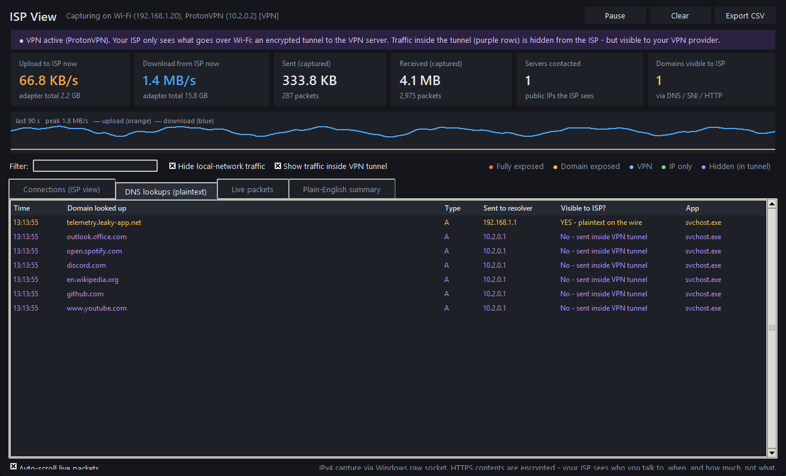
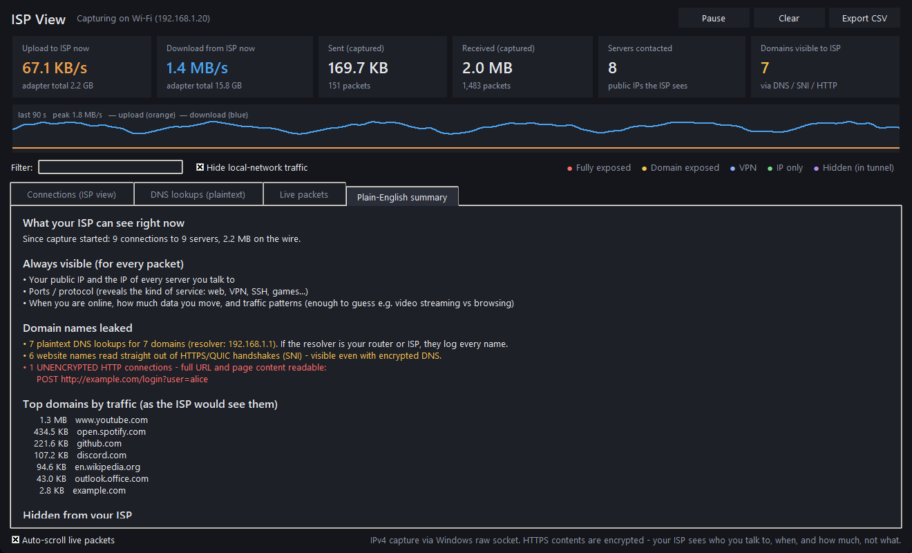

<div align="center">

# 👁️ ISP View

### See your internet connection the way your ISP sees it.

**A tiny, free Windows app that watches your traffic live and shows, connection by connection, what your Internet provider can see, what it can't, and whether your VPN is actually doing its job.**




</div>

---

## 🐧 "I use a VPN to download Linux ISOs." Sure you do. 😉

Whatever *you* use a VPN for, the important question is the same:

> **Is my ISP actually blind right now, or am I just *hoping* it is?**

VPN apps show a green "Connected" badge and ask you to trust them. Leak-test websites check one moment from inside your browser. Neither shows what really goes out over your cable or Wi-Fi.

**ISP View does.** It reads every packet on your real network adapter (the one your ISP is connected to) and tells you in plain English:

- ✅ **"Only that you use a WireGuard VPN to this server."** This is what you want to see.
- 🟣 **"Nothing: inside your VPN tunnel."** Your torrents, *ahem*, Linux ISOs, browsing and DNS all stay out of the ISP's view.
- 🟡 **"Website name (TLS SNI)."** A domain name leaked outside the tunnel.
- 🔴 **"Every domain name you look up (plaintext DNS)."** A DNS leak, along with the app that caused it.

If a red or yellow row appears while your VPN is on, **something is leaking**. You'll see exactly which app, which domain, and when.

---

## ✨ Features

| | |
|---|---|
| 🔍 **Real ISP's-eye view** | Captures on your physical adapter *and* your VPN adapter at the same time, so it can tell "on the wire" traffic from "inside the tunnel" traffic. |
| 🕳️ **VPN leak detection** | Catches DNS leaks, split-tunnel apps, traffic after the kill switch fails, and IPv4 traffic that slips past the tunnel, **as it happens**. |
| 🧅 **Recognises VPN tunnels** | Fingerprints WireGuard packets, and flags OpenVPN / IPsec ports and VPN client processes. Works with ProtonVPN, Mullvad, NordVPN, Surfshark, PIA, Windscribe, plain WireGuard and more. |
| 🌐 **Domain leak decoding** | Reads domain names the way an ISP can: plaintext DNS queries, the **TLS SNI** in HTTPS handshakes, and **QUIC/HTTP3 Initial packets** (they're encrypted, but with publicly known keys, so ISP View decrypts them just as an ISP could). |
| 🚨 **Plaintext alarms** | Shows full URLs of unencrypted HTTP requests, which is exactly what anyone on the path can read. |
| 🧑‍💻 **Per-app attribution** | Every connection is tagged with the program that opened it (`brave.exe`, `qbittorrent.exe`, `Discord.exe`…). |
| 📈 **Live bandwidth** | Upload/download speed on the wire, with a 90-second graph. |
| 📝 **Plain-English summary** | A readable report of what's exposed, what's hidden, and your top domains by traffic. |
| 💾 **CSV export** | Save every connection and DNS lookup for later. |
| 🪶 **Tiny & self-contained** | One ~11 MB `.exe`. No Npcap/WinPcap, no installer, no account, no cloud. |

---

## 📸 Screenshots

<table>
<tr>
<td width="50%"><b>VPN off</b>: your ISP sees every site you visit (SNI + DNS), and plaintext HTTP in full.<br></td>
<td width="50%"><b>Leak caught</b>: VPN on, but one app resolves a domain outside the tunnel.<br></td>
</tr>
<tr>
<td colspan="2"><b>Plain-English summary</b><br></td>
</tr>
</table>

<sub>Screenshots use synthetic demo traffic.</sub>

---

## 🚀 Get it

### Option A: download the .exe
1. Grab **`ISPView.exe`** from the [**Releases**](../../releases) page.
2. Double-click it and accept the Administrator prompt. Windows only lets admin programs see raw packets.
3. Browse, stream, download ~~torrents~~ Linux ISOs, and watch the rows appear.

> Windows SmartScreen / antivirus may warn you because the exe is unsigned and built with PyInstaller. The full source is the single file [`isp_view.py`](isp_view.py). Read it, or run it directly (Option B).

### Option B: run from source
```bash
pip install -r requirements.txt
python isp_view.py
```

### Build your own .exe
```bash
build.bat
```
The result is `dist\ISPView.exe`.

---

## 🧠 What can your ISP actually see?

| | VPN **off** | VPN **on** (working) | VPN **on** (leaking) |
|---|:---:|:---:|:---:|
| Your public IP & when you're online | 👁️ | 👁️ | 👁️ |
| How much data you move | 👁️ | 👁️ | 👁️ |
| That you use a VPN | – | 👁️ | 👁️ |
| IPs of the sites you visit | 👁️ | 🙈 | 👁️ for leaked apps |
| Domain names (DNS / SNI / QUIC) | 👁️ | 🙈 | 👁️ for leaked apps |
| Full URLs & content of HTTP sites | 👁️ | 🙈 | 👁️ for leaked apps |
| Page contents of HTTPS sites | 🙈 | 🙈 | 🙈 |

ISP View fills in the "leaking" column for **your** machine, live.

---

## ⚙️ How it works

- **Capture:** opens a Windows raw socket with `SIO_RCVALL` on every active IPv4 adapter. This is built into Windows, so no driver install is needed.
- **Tunnel awareness:** adapters whose names look like VPNs (WireGuard, Wintun, TAP, Proton, Mullvad, …) count as *inside the tunnel*. Everything else counts as *on the wire*.
- **Decoding** (only what a passive ISP could decode):
  - DNS queries and answers on UDP/53
  - TLS ClientHello → SNI, reassembled across TCP segments
  - QUIC v1 Initial packets → decrypted with the RFC 9001 public salt → CRYPTO frames reassembled → SNI
  - HTTP request lines and `Host:` headers
  - WireGuard message-type fingerprints
- **Process mapping:** local ports are matched to processes through `psutil`.
- **100% local:** the app makes no network connections of its own, collects no telemetry, and only writes to disk when you click *Export CSV*.

---

## ⚠️ Honest limitations

- **Windows only.**
- **IPv4 only.** IPv6 packets aren't listed one by one, although the speed graph still includes them. If your VPN doesn't handle IPv6, check it separately.
- Windows raw sockets don't receive **incoming TCP** packets on some adapters, so per-connection download totals can be low. Outgoing traffic, DNS, SNI and leak detection are unaffected, and the speed cards use the adapter's own counters.
- **Encrypted Client Hello (ECH)** and **DNS-over-HTTPS** hide domain names from your ISP *and* from ISP View. That's a good thing.
- Like your ISP, ISP View can't read inside HTTPS. It shows *metadata*, not content.

---

## ❓ FAQ

**Does this hack or spy on anyone?**
No. It only shows traffic from your own computer, the same metadata your ISP already sees.

**Why does it need Administrator?**
Raw packet capture is an admin-only feature in Windows.

**Does it work with my VPN?**
If your VPN creates a network adapter (almost all do), yes. WireGuard-based VPNs are recognised by packet fingerprint. Other protocols are recognised by port or process name.

**I see a red DNS row with the VPN on. Now what?**
Note the app in the row. Then turn on your VPN's DNS leak protection / kill switch, turn off "smart multi-homed name resolution" in Windows, or set your browser to use secure DNS.

**Does a VPN make illegal things legal?**
No. ISP View is a privacy and transparency tool. Use it to understand your own network, and follow the laws where you live. 🐧

---

## 📄 License

[MIT](LICENSE). Free to use, fork, and improve. Stars ⭐ help other people find it.
